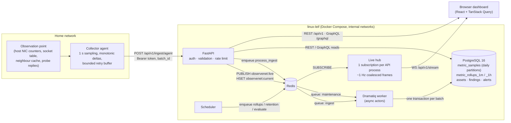

# ObserveNet architecture

ObserveNet is a self-hosted home-network observability platform with a read-only
posture-verification workflow (Discover → Assess → Prioritize → Fix → Verify → Monitor).
It runs as a small Docker Compose stack on one Linux host. This document describes what
is implemented in this repository; anything not built is called out as such.

## Components

| Component | Code | Role |
|---|---|---|
| Linux collector | `agents/linux/observenet_agent/` | Samples host NIC counters at 1 Hz, runs a short validated probe list, reads the neighbour cache and the socket table, uploads batches. Read-only. |
| Windows agent (optional) | `agents/windows/observenet-agent.ps1` | NIC counters, firewall profiles, SMB setting, listening sockets. **Not executed in the build environment** — see `LIMITATIONS.md`. |
| API | `backend/observenet/api/` | FastAPI: REST (`/api/v1`), GraphQL (`/graphql`), WebSocket (`/api/v1/stream`). Authenticates, validates, fans out live frames, enqueues durable work. |
| Worker | `backend/observenet/workers/tasks.py` | Dramatiq actors (async) on Redis: batch persistence, rollups, retention, alert evaluation, verification deadlines, outage tracking. |
| Scheduler | `backend/observenet/workers/scheduler.py` | One small loop that enqueues the periodic actors and, in `DEMO_MODE`, runs the synthetic generator. |
| PostgreSQL 16 | `backend/migrations/` | System of record: inventory, time series (partitioned raw + rollups), probes, alerts, findings/evidence, auth, audit. |
| Redis 7 | — | Dramatiq broker, live pub/sub channel, "current value" hash, rate-limit counters, worker heartbeats. |
| Web | `frontend/` behind nginx | React SPA; nginx serves static files and proxies `/api` and `/graphql` (including the WebSocket upgrade) to the API. |

## Data path

Step by step:

1. **Observation point → collector.** The agent reads cumulative counters and derives
   rates with a monotonic clock (`agents/linux/observenet_agent/rates.py`). When a rate
   cannot be derived honestly (first reading, counter reset, gap > 3 intervals) it emits
   nothing. Every posture/inventory section carries `status: ok | unavailable |
   unsupported | disabled` plus a reason.
2. **Collector → API.** One `POST /api/v1/ingest/agent` per second with a random
   `batch_id`. Failed uploads stay in a bounded deque (300 batches) and are retried with
   the same `batch_id`. Non-retryable 4xx responses drop the batch and are logged.
3. **API (`services/ingest.py: accept`).** Resolves the bearer token (HMAC digest
   lookup), binds the token to exactly one agent on first use, rejects clock skew
   > 120 s and unit mismatches, then:
   - publishes a compact live frame on Redis channel `observenet:live` and updates the
     `observenet:current` hash (latest value per series);
   - enqueues `process_ingest(source_id, payload, received_at)` on the `ingest` queue.
   The request does no heavy database work. If Redis is unavailable it returns 503 and
   the agent retries the same batch.
4. **Worker (`process_batch`).** One transaction per batch:
   - takes `pg_advisory_xact_lock(7041, source_id)` so batches of the same source are
     serialized while different sources run in parallel;
   - inserts the `(source_id, batch_id)` ledger row with `ON CONFLICT DO NOTHING`; if it
     already exists the batch is a duplicate and nothing else happens;
   - upserts series, bulk-inserts samples (`ON CONFLICT (series_id, ts) DO NOTHING`),
     probe results, heartbeat/capabilities, inventory (interfaces, segments, neighbour
     sightings → identity reconciliation) and posture (snapshot → rules → findings →
     verification).
   Ledger row and all writes commit together, so a retried task is a no-op.
5. **Rollups and retention.** `run_rollups` (every 60 s) recomputes complete minute
   buckets since a watermark (re-deriving the last 120 s every run for late data) and the
   affected hour buckets, both as idempotent upserts. `run_retention` (every 15 min)
   creates daily partitions ahead of time and drops whole day-partitions that aged out.
6. **Read paths.**
   - REST `GET /api/v1/metrics/history` picks the table by bucket width: < 60 s → raw,
     < 1 h → `metric_rollups_1m`, ≥ 1 h → `metric_rollups_1h`. At most 1500 points per
     series; empty buckets are returned as `null`, not zero.
   - GraphQL serves graph-shaped inventory reads with batched loaders.
   - WebSocket `/api/v1/stream` pushes one coalesced frame per second from pub/sub.
     There is no database query per browser per second.

## Technology choices

| Choice | Why | Cost |
|---|---|---|
| Python 3.12, FastAPI, Pydantic v2 | Typed request/response contracts; the OpenAPI document drives frontend types. | — |
| SQLAlchemy 2.0 async + psycopg 3 | One driver and one async code path for API and workers. | Pinned `<2.1` (ADR 0005). |
| PostgreSQL for everything, including time series | One datastore to run, back up and reason about; relational joins between inventory, evidence and metrics. | Not a TSDB: no compression, limited to home scale (ADR 0001). |
| Redis + Dramatiq (async actors) | Explicit queue, retries with backoff, time limits, message age limits. Redis is also the live fan-out bus. | Redis is a second stateful service; queue is not persisted across a Redis data loss unless AOF/RDB is on. |
| Separate scheduler process | Workers can scale out without duplicating ticks. Duplicate ticks would be harmless anyway (all periodic actors are idempotent). | One more container. |
| Strawberry GraphQL (read-only) | Inventory is a graph; clients pick fields; dataloaders prevent N+1. | Second API surface to secure (ADR 0003). |
| React + TypeScript + Vite + TanStack Query | Typed client, cache/invalidation, small bundle. | — |
| structlog + OpenTelemetry + prometheus_client | JSON logs with trace ids; spans exported only if an OTLP endpoint is configured; metrics on a separate internal listener. | — |

## Reliability properties

- **Idempotent ingestion.** `(source_id, batch_id)` ledger + `(series_id, ts)` primary
  key + `(target_id, source_id, ts)` unique probe results. Replays and retries never
  double-count.
- **Ordering.** Samples carry their own timestamps. `data_sources.last_seen_at` only
  moves forward. A posture snapshot older than the newest one already seen is ignored
  for state transitions.
- **Backpressure.**
  - Agent: bounded buffer; oldest batches are dropped when full and the drop count is
    reported in the heartbeat.
  - API: per-token ingest rate limit (default 240/min).
  - Live hub: each WebSocket client has a 5-frame queue. A client that cannot keep up is
    disconnected (close code 4408) and resyncs from the snapshot on reconnect.
  - Queue: periodic messages carry `max_age`, so a backlog built while the worker was
    down is discarded instead of replayed.
- **Worker down.** Batches accumulate in Redis; the live path keeps working (pub/sub is
  independent of persistence); history lags; `GET /api/v1/status` reports the missing
  worker heartbeat and queue depth.
- **Redis down.** Ingest returns 503 (agents buffer). Login rate limiting degrades to a
  per-process counter rather than failing open. The dashboard shows live values as
  unavailable.

## Retention and partitioning

| Table | Default retention | Mechanism |
|---|---|---|
| `metric_samples` (1 s) | 48 h | `PARTITION BY RANGE (ts)`, one partition per UTC day (`metric_samples_pYYYYMMDD`), dropped whole. A `metric_samples_default` partition is the safety net; its rows are deleted by range. |
| `metric_rollups_1m` | 90 d | `DELETE` by bucket |
| `metric_rollups_1h` | 365 d | `DELETE` by bucket |
| `probe_results` | 48 h | `DELETE` by ts |
| `collector_heartbeats`, `ingest_batches` | same as raw | `DELETE` |
| `events` | 365 d | `DELETE` |
| `posture_snapshots` | 90 d | `DELETE`, except snapshots referenced by finding evidence |

All values are runtime settings (`services/settings.py`, Settings page). Rough volume:
~20 series per agent × 86 400 samples/day ≈ 1.7 M raw rows/day/agent, bounded at 48 h.

## REST vs GraphQL

- **REST** for commands (acknowledge, verify, settings), ingestion, time series and the
  live stream: simple, cacheable or streamable contracts; CSRF and audit per endpoint.
- **GraphQL** for inventory reads (`devices`, `device`, `findings`, `assessments`,
  `networkSummary`): a device has identities, addresses, interfaces, services, findings
  and relationships, and different screens need different slices. Loaders batch each
  child collection into one `IN (...)` query.
- GraphQL is read-only. Safety: session cookie + CSRF header on POST, GET queries
  disabled, depth limit (default 8), alias limit 15, token limit 2000, page size ≤ 100,
  introspection and GraphiQL disabled in production, admin-only field
  (`Device.auditTrail`).

## Trade-offs

- **Time series in PostgreSQL.** Fine at this scale with partition drops and rollups.
  It would not hold at hundreds of agents or sub-second sampling; the series/sample
  split and the bucket-resolution rule keep a later move to TimescaleDB or a TSDB
  contained in `services/timeseries.py`.
- **False positives.** Findings are deterministic rules over data the host itself
  reported. A wildcard listener is reported as `POTENTIAL_EXPOSURE` with the inference
  labelled; severity rationale is stored with the finding. Allowlists exist for intended
  listeners. Alerts use debounce, hysteresis and cooldown; missing data is "unknown" and
  neither fires nor clears.
- **Coverage.** One LAN host cannot see other devices' traffic. WAN and per-device
  metrics show `Unsupported` until a gateway source exists. Inventory from a neighbour
  cache is partial by construction.
- **Reliability.** Single node, no HA. Losing the host loses monitoring; data survives
  in the `pgdata` volume and in backups if taken.
- **Privacy.** Inventory (MACs, hostnames, IPs) stays in the local database. No
  third-party analytics. Outbound traffic by default: probe handshakes to the configured
  external targets and, if enabled, the tunnel and webhook.
- **Edge access.** The stack publishes one port on 127.0.0.1. Remote access is designed
  around an outbound-only tunnel with an edge access policy in front of the application
  login (`DOMAIN_AND_AUTH.md`). That path is documented, not deployed.

## Not implemented (see `LIMITATIONS.md`)

- No SNMP or vendor router adapter; the provider interface and a client-list import
  exist.
- Neo4j projection (optional `graph` profile): an idempotent projection of the same topology, implemented in `services/graph_sync.py`; PostgreSQL remains the source of truth (ADR 0006).
- No email notifications; in-app alerts plus an optional signed webhook.
